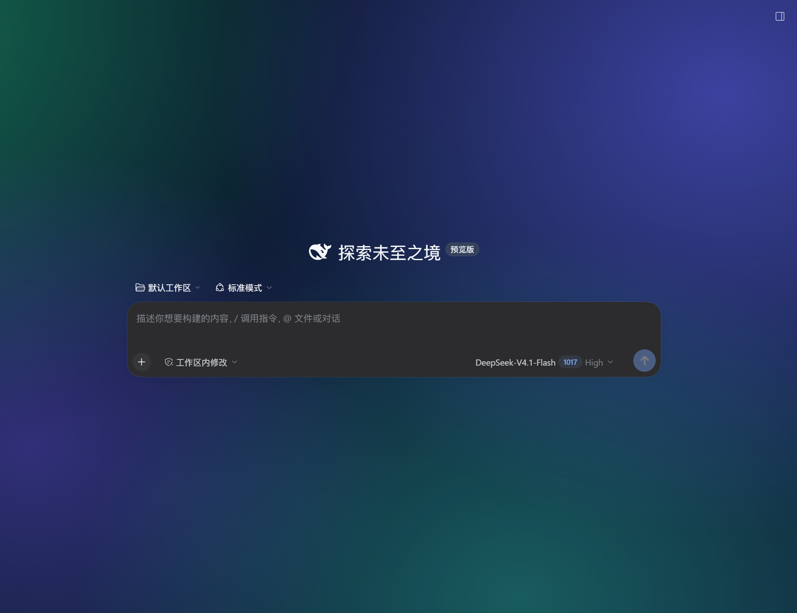
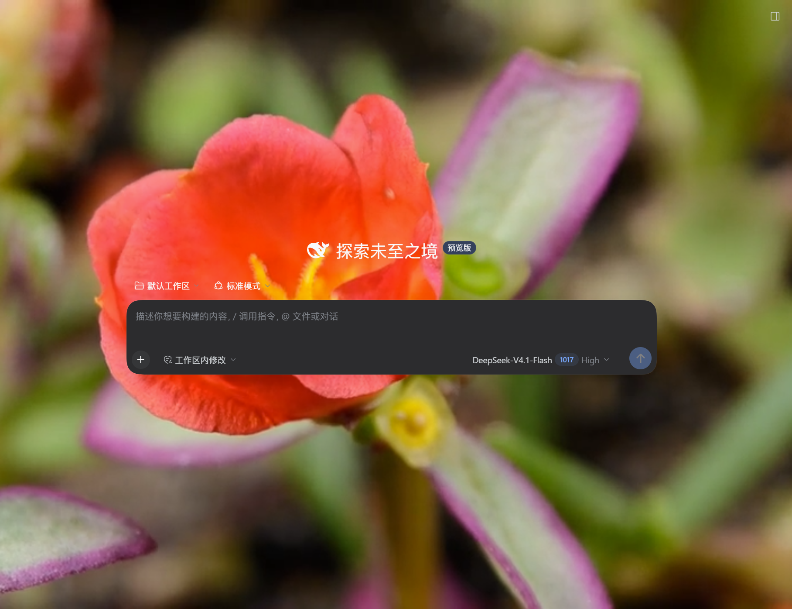

# DSH Wallpaper · DSH 壁纸

[English](#english) | [中文](#中文)

为 DeepSeek Harness 的 Web GUI 添加可自定义背景(壁纸)的客户端插件。支持静态图片与**动态视频壁纸**,内置多种动画场景,并带一个可视化设置面板。

A DeepSeek Harness client plugin that adds a customizable background (wallpaper) to the Web GUI — static images, **dynamic video wallpapers**, built-in animated scenes, and a visual settings panel.




---

<a id="中文"></a>

## ✨ 功能

- **动态视频壁纸** — 支持 mp4/webm 等直链或本地文件,循环播放、可静音、可调速
- **静态图片壁纸** — URL 直链或本地上传(存于浏览器 IndexedDB,刷新不丢)
- **内置动画场景** — 极光 / 晚霞 / 深海,纯 CSS 动画,零依赖
- **精细调节** — 不透明度、模糊、压暗滑杆,实时预览
- **应用透明化** — 自动清除遮挡视口的应用容器背景(静态选择器 + 运行时自动扫描双重保障)
- **自愈迁移** — 检测到"设置后不可见"的坏状态(无图源/透明化关闭/不透明度过低)时自动恢复为可见配置
- **可视化设置面板** — 侧边栏"壁纸"按钮打开,所有配置自动持久化
- **诊断回传** — 页面可见性分析自动写入 localStorage,可从磁盘排查问题

## 📦 安装

> 要求:DeepSeek Harness 0.2.x,Web GUI(desktop 或浏览器访问均可)

### 方式一:插件管理器(推荐)

1. 把本仓库 clone 到本地任意**固定目录**(安装后请勿移动)
2. 在 DSH 会话中让 agent 执行:`plugin_manager`,action `install_bundle`,target 填仓库目录

### 方式二:CLI

```powershell
git clone https://github.com/lfk6666/dsh-wallpaper.git D:\dsh-plugins\dsh-wallpaper
dsh plugin --profile <你的profile> add "link:D:\dsh-plugins\dsh-wallpaper"
```

> Desktop 应用自管的 profile 由应用独占管理,请使用其 Web 侧边栏的"插件"页操作。

### 方式三:手动

把仓库目录链接/复制到 profile 的 `node_modules`,在 profile 的 `package.json` 中:

1. `dependencies` 添加 `"@local/dsh-wallpaper": "link:<仓库绝对路径>"`
2. `dsh.profile.bundles` 数组追加 `"@local/dsh-wallpaper"`
3. 运行 `pnpm install` 后重启 DSH

## 🖥️ 使用

1. 刷新页面(或重启 DSH),侧边栏底部出现"**壁纸**"按钮
2. 点开面板,选择壁纸类型:
   - **内置动画** — 极光/晚霞/深海,开箱即用
   - **图片 / 视频** — 填入 http(s) 直链,或点击"上传文件"
3. 用滑杆调节不透明度 / 模糊 / 压暗;视频可控制静音与倍速
4. 保持"**应用透明化**"开启(关闭后壁纸会被应用背景遮挡)
5. 一切实时生效,自动保存

## 🔧 工作原理

插件注册一个固定定位、`z-index: -1` 的全视口背景层(挂载于 `shell.overlay` 插槽并通过 React Portal 渲染到 `documentElement`,不受页面切换与祖先层叠上下文影响),同时通过静态选择器 + 运行时扫描把应用的结构性不透明容器透明化,让背景透出。设置面板注册在 `sidebar.footer.action` 插槽。

详细机制见 [client.js](client.js) 源码注释。

## 📁 目录结构

```
├── package.json        # DSH bundle + client 声明
├── cordis.patch.yml    # 插件行插入声明
├── index.js            # Host 半侧
├── client.js           # Client 半侧(背景层 + 设置面板,无构建步骤)
├── icon.svg            # 插件图标
├── locale/             # 展示元信息(zh/en)
└── docs/               # 截图
```

## ⚠️ 已知限制

- 上传的媒体文件存于浏览器 IndexedDB(桌面端在 C 盘 AppData);大文件建议使用 URL 模式
- DSH 版本升级后如类名哈希变化导致遮挡,可在面板"补充 CSS"中自行修复,或提 issue
- 仅在 0.2.1-rc.3 上验证;插件 API 后续版本可能有变化

## 📄 License

[MIT](LICENSE)

---

<a id="english"></a>

## ✨ Features

- **Dynamic video wallpapers** — mp4/webm via URL or local file, loop / mute / playback-rate
- **Static image wallpapers** — URL or local upload (stored in IndexedDB, survives reloads)
- **Built-in animated scenes** — Aurora / Sunset / Ocean, pure CSS
- **Fine tuning** — opacity, blur, dim sliders with live preview
- **App transparency** — clears opaque structural containers via static selectors + a runtime auto-scan
- **Self-healing** — broken states (missing source / transparency off / too-low opacity) are auto-recovered
- **Visual settings panel** — "壁纸" button in the sidebar footer, everything persists automatically
- **Diagnostics** — page visibility analysis dumped to localStorage for external troubleshooting

## 📦 Install

```powershell
git clone https://github.com/lfk6666/dsh-wallpaper.git
dsh plugin --profile <profile> add "link:<repo path>"
```

or use the `plugin_manager` tool (`install_bundle`) / the web Plugin page in DSH.

## 🖥️ Usage

Refresh the page, click the "**壁纸**" button in the sidebar footer, pick a wallpaper type (built-in animation / image / video), tune the sliders. Keep "**应用透明化**" enabled or the wallpaper stays hidden behind the app background. Everything applies live and persists.

## 📄 License

[MIT](LICENSE)
